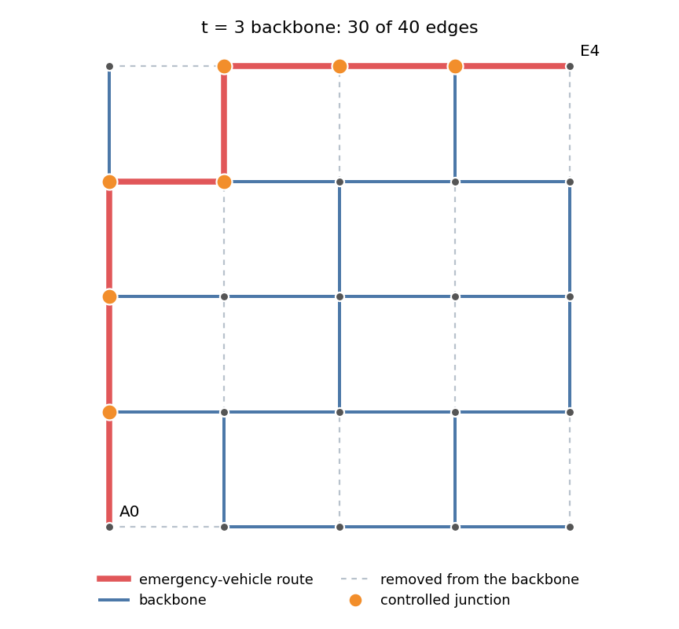
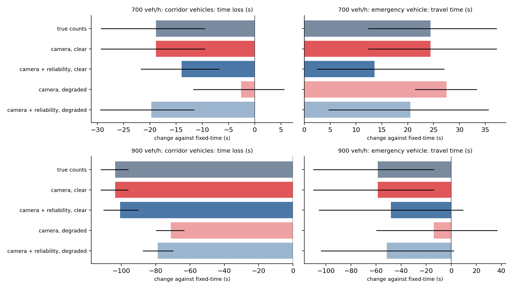

# perception-aware-corridor-control

<p align="center"></p>

**Does a corridor controller do better when it is told how far to trust its camera? A backbone route, a fuzzy green-split rule base and a reliability-weighted input, tested in SUMO with an emergency vehicle.**

A camera-based signal controller usually receives a vehicle count and nothing about the quality of that count. When the camera degrades (rain, glare, dirt) the count is too low, and a controller that trusts it shortens the wrong greens. This package asks whether passing a reliability score to the controller, so that it falls back on what it learned in good conditions when the score is low, recovers the loss. The corridor is a route on a spanner backbone of the street grid, and only the junctions of that route are controlled. Nothing is trained and no detector is run: perception is emulated at its interface (counts that miss vehicles, and a lagged reliability score).

<p align="center"></p>

## Method in one paragraph

On a 5 x 5 signalised grid the greedy 3-spanner keeps 30 of 40 street segments; the shortest backbone route between two corners has stretch 1.0 and passes 7 signals. Demand is a random background plus a heavy flow along the route (700 or 900 vehicles per hour). At the start of each green, a four-rule Sugeno fuzzy system sets the green time from the vehicle counts on the served and on the competing approaches. Three count sources are compared: the true counts (oracle), the emulated camera counts (naive), and the emulated counts shrunk towards a running prior by the reliability score r (aware: r x count + (1 - r) x prior). A camera degradation episode (300 to 750 s, severity 0.7) removes up to 56 % of the vehicles from the counts, and r follows the degradation with a lag of a few seconds. An emergency vehicle is preempted on the route in all conditions. Full definitions: [`docs/METHODS.md`](docs/METHODS.md).

## Installation (Ubuntu / WSL2)

```bash
python3 -m venv .venv && source .venv/bin/activate
pip install -e ".[sumo,dev]"
pytest
```

## Usage

```bash
pacc-eval --corridor-vph 700 --seeds 12 --jobs 2 --out results/eval700     # about 5 min on one core
pacc-eval --corridor-vph 900 --seeds 12 --jobs 2 --out results/eval900
pacc-figures --summary results/eval700/summary.json results/eval900/summary.json \
  --labels "700 veh/h" "900 veh/h" --out docs/assets/corridor_results.png
```

## Results (SUMO, 12 seeds, paired by seed)

Time loss of the vehicles of the corridor flow and travel time of the emergency vehicle (EV), with the change against fixed-time control and a percentile bootstrap 95% interval over seeds. In the clear condition the emulated counts are exact, so *camera, clear* equals *true counts* by construction.

**Corridor flow of 700 vehicles per hour**

| controller | corridor time loss (s) | change vs fixed [95% CI] | EV travel time (s) | change vs fixed [95% CI] |
|---|---|---|---|---|
| fixed-time | 139.6 | | 139.5 | |
| true counts | 120.7 | -18.8 [-29.3, -9.6] | 163.9 | +24.4 [12.4, 37.2] |
| camera, clear | 120.7 | -18.8 [-29.3, -9.6] | 163.9 | +24.4 [12.4, 37.2] |
| camera + reliability, clear | 125.6 | -13.9 [-21.7, -6.9] | 153.1 | +13.6 [2.5, 27.0] |
| camera, degraded | 137.0 | -2.6 [-11.7, 5.6] | 167.0 | +27.5 [21.5, 33.3] |
| camera + reliability, degraded | 119.8 | -19.7 [-29.4, -11.6] | 160.0 | +20.5 [4.7, 35.6] |

**Corridor flow of 900 vehicles per hour (fixed-time operation is close to saturation)**

| controller | corridor time loss (s) | change vs fixed [95% CI] | EV travel time (s) | change vs fixed [95% CI] |
|---|---|---|---|---|
| fixed-time | 256.8 | | 264.7 | |
| true counts | 153.2 | -103.6 [-111.8, -96.1] | 206.1 | -58.6 [-109.8, -13.9] |
| camera, clear | 153.2 | -103.6 [-111.8, -96.1] | 206.1 | -58.6 [-109.8, -13.9] |
| camera + reliability, clear | 156.2 | -100.6 [-110.1, -90.1] | 216.5 | -48.2 [-105.4, 9.3] |
| camera, degraded | 185.6 | -71.1 [-79.7, -63.5] | 250.6 | -14.1 [-59.6, 36.3] |
| camera + reliability, degraded | 178.0 | -78.8 [-87.3, -69.9] | 213.3 | -51.3 [-103.6, 1.8] |

Reliability-aware against naive, same seeds (negative: aware is better):

| demand | camera | corridor time loss (s) | EV travel time (s) |
|---|---|---|---|
| 700 veh/h | clear | +4.9 [-2.9, 12.3] | -10.8 [-27.3, 3.5] |
| 700 veh/h | degraded | -17.1 [-23.5, -11.1] | -7.0 [-23.4, 7.9] |
| 900 veh/h | clear | +2.9 [-3.1, 9.6] | +10.4 [-6.8, 28.8] |
| 900 veh/h | degraded | -7.7 [-16.9, 1.6] | -37.2 [-69.0, -4.8] |

<p align="center"></p>

- **Adaptive green splits reduce the corridor delay** relative to fixed-time operation when the counts are right: by 18.8 s at 700 veh/h and 103.6 s at 900 veh/h (true counts).
- **A degraded camera removes most of that gain at 700 veh/h** (naive: -2.6 s, interval including zero) **and a third of it at 900 veh/h** (naive -71.1 s against -103.6 s).
- **Passing the reliability score recovers the loss at 700 veh/h** (aware against naive: -17.1 [-23.5, -11.1] s) and **gives a smaller, not significant gain at 900 veh/h** on corridor delay (-7.7 [-16.9, 1.6] s), where the emergency vehicle is faster (interval excludes zero; -37.2 [-69.0, -4.8] s).
- **With a healthy camera the reliability weighting costs little**: the differences against naive are positive but their intervals include zero (+4.9 [-2.9, 12.3] s and +2.9 [-3.1, 9.6] s).
- **The emergency vehicle is slower with adaptive control at 700 veh/h** than under fixed-time operation (+13.6 to +27.5 s, all intervals above zero), although it is preempted in every condition. The cause was not isolated here; at 900 veh/h the sign reverses and the intervals include zero except for the oracle and naive-clear conditions. Other vehicles' delay is within about 3 s of fixed-time in all conditions.

## Route on a backbone with larger stretch (B0 to E4, t = 7)

With the origin A0 and destination E4 the backbone route equals the shortest route for every t from 3 to 50 on this grid (stretch 1.0), so the backbone cannot change the route there. For B0 to E4 and t = 7 the greedy spanner keeps 26 of 40 segments and the backbone route is 28.4 % longer in free-flow time than the shortest route (9 against 7 segments; the backbone route goes B0, B1, A1, A2, A3, B3, B4, C4, D4, E4, the shortest route B0, B1, B2, B3, B4, C4, D4, E4). The same study (12 seeds, paired, true counts, healthy and degraded camera) was run with the emergency vehicle and the corridor flow on each route (`pacc-eval --origin B0 --dest E4 --stretch 7 --route-mode backbone|shortest`).

| route | demand | fixed-time EV time (s) | oracle EV change (s) | aware minus naive, degraded: EV time (s) | aware minus naive, degraded: corridor delay (s) |
|---|---|---|---|---|---|
| backbone | 700 veh/h | 161.2 | +31.4 [+11.8, +51.7] | +15.9 [-13.8, 45.3] | -13.7 [-25.4, -2.5] |
| shortest | 700 veh/h | 119.4 | -5.3 [-9.2, -0.6] | -22.9 [-35.3, -10.1] | -28.0 [-34.6, -21.9] |
| backbone | 900 veh/h | 171.3 | +41.2 [+17.6, +66.4] | +0.3 [-31.3, 33.3] | -0.1 [-6.1, 6.0] |
| shortest | 900 veh/h | 135.9 | -12.3 [-17.0, -6.8] | -32.2 [-38.8, -24.7] | -17.3 [-22.7, -11.8] |

- **The backbone route costs the emergency vehicle far more than its free-flow stretch**: under fixed-time control it needs 161.2 s at 700 veh/h against 119.4 s on the shortest route (+35 %), and 171.3 s against 135.9 s at 900 veh/h (+26 %). Both are single-OD observations; the delay per junction was not analysed.
- **On the shortest route adaptive control speeds up the emergency vehicle with a healthy camera** (oracle: -5.3 and -12.3 s, intervals below zero), whereas on the backbone route it slows it down (+31.4 and +41.2 s, intervals above zero). The slow-down seen for A0 to E4 at 700 veh/h is therefore not a general property of the adaptive controller; its cause is still not isolated.
- **With a degraded camera the reliability score helps on the shortest route** (aware minus naive: EV time -22.9 and -32.2 s, corridor delay -28.0 and -17.3 s, intervals below zero); on the backbone route the EV intervals include zero and only the corridor delay at 700 veh/h is below zero.
- The corridor flow follows the route in each mode, so route and corridor load are changed together; fixed-time corridor delays differ between modes (191.3 against 85.1 s at 700 veh/h).

### Where the emergency vehicle loses time (700 veh/h, B0 to E4, healthy camera)

`pacc-eval --trace` records, for every simulation step in which the emergency vehicle is on a street segment, the time spent there, the time it stood still and the number of vehicles ahead of it in its lane (`docs/results/edge_summary_*_700.csv`, per-seed rows in `edge_trace_*_700.csv`). Time on the segments only (junction interiors excluded), means over 12 seeds:

| route | segment | fixed-time (s) | oracle (s) | change [95% interval] (s) | vehicles ahead, fixed / oracle |
|---|---|---|---|---|---|
| backbone | B0B1 | 12.6 | 19.5 | +6.9 [+4.1, +9.3] | 0.1 / 2.3 |
| backbone | A1A2 | 13.2 | 37.8 | +24.6 [+20.2, +29.4] | 1.4 / 4.7 |
| backbone | A3B3 | 32.9 | 25.6 | -7.3 [-24.3, +6.9] | 4.2 / 2.0 |
| shortest | B3B4 | 25.2 | 14.0 | -11.2 [-12.6, -9.8] | 4.5 / 2.3 |
| shortest | B4C4 | 23.2 | 18.4 | -4.8 [-6.7, -2.8] | 5.0 / 3.7 |

- Under fixed-time control the backbone route spends 144.8 s on its segments against 108.8 s on the shortest route; most of the difference is on the three segments A1A2, A2A3 and A3B3 (68.2 s against the 22.2 s the shortest route needs for the two segments B1B2 and B2B3).
- With adaptive control the extra time on the backbone route comes mostly from one segment, A1A2 (+24.6 s), where the number of vehicles ahead of the emergency vehicle rises from 1.4 to 4.7 and it stands still for 3.3 s on average. On the shortest route the adaptive controller shortens the time on the two segments that hold the longest queues under fixed-time control.
- This is descriptive: queues ahead of the emergency vehicle go together with its delay, but the study does not intervene on them, so it does not show that the queue is the cause. A preempted green does not clear vehicles that stand in the emergency vehicle's lane.

### Does earlier preemption remove the delay on the backbone route? (700 veh/h, B0 to E4)

The signal turns green for the emergency vehicle once it is within `--preempt-m` of the stop line (default 80 m; segments are 150 m, so 150 m means as soon as it enters the segment). The same study (12 seeds, paired, healthy camera unless noted) was repeated with 150 m (`docs/results/preempt150_*_700_runs.csv`, `edge_*_700_p150.csv`).

| route | quantity | 80 m | 150 m | change [95% interval] (s) |
|---|---|---|---|---|
| backbone | segment A1A2, oracle (s) | 37.8 | 37.4 | -0.3 [-4.8, +4.2] |
| backbone | emergency-vehicle time, oracle (s) | 192.7 | 186.2 | -6.5 [-20.7, +8.3] |
| backbone | emergency-vehicle time, fixed-time (s) | 161.2 | 149.4 | -11.8 [-27.8, +0.2] |
| shortest | emergency-vehicle time, oracle (s) | 114.1 | 105.9 | -8.2 [-12.8, -4.1] |
| shortest | emergency-vehicle time, fixed-time (s) | 119.4 | 114.8 | -4.6 [-7.9, -1.5] |
| shortest | emergency-vehicle time, degraded camera, naive (s) | 147.8 | 116.2 | -31.6 [-40.6, -22.7] |

- Earlier preemption does **not** remove the extra delay on segment A1A2 of the backbone route: the interval around the change contains zero and the oracle controller still needs 37.4 s there.
- With 150 m the oracle controller is still slower than fixed-time control on the backbone route (+36.8 [+26.9, +48.0] s) and faster on the shortest route (-8.9 [-13.2, -4.5] s). The sign of the controller effect therefore does not depend on the preemption distance in this study.
- On the shortest route earlier preemption shortens the emergency vehicle's time under every controller, most strongly with a degraded camera and the naive counts (-31.6 s).
- The cause of the delay on A1A2 is still not isolated; the queue-ahead association from the previous table stands as descriptive only.

## Claims and evidence

| claim | evidence | file |
|---|---|---|
| fuzzy green splits reduce corridor delay when counts are right | 700 veh/h: -18.8 [-29.3, -9.6] s; 900 veh/h: -103.6 [-111.8, -96.1] s | `docs/results/summary_*.json` |
| a degraded camera removes the gain | naive degraded at 700 veh/h: -2.6 [-11.7, 5.6] s | `docs/results/summary_700.json` |
| the reliability score recovers it | aware minus naive, degraded, 700 veh/h: -17.1 [-23.5, -11.1] s | `docs/results/summary_700.json` |
| the reliability score helps at saturation | **partially supported**: corridor delay -7.7 [-16.9, 1.6] s (interval includes zero), EV time -37.2 [-69.0, -4.8] s | `docs/results/summary_900.json` |
| the reliability weighting is free in clear conditions | **partially supported**: +4.9 and +2.9 s on corridor delay, intervals include zero | `docs/results/summary_*.json` |
| adaptive control speeds up the emergency vehicle | **not supported** at 700 veh/h (slower by 13.6 to 27.5 s, intervals above zero); at 900 veh/h faster with true counts or a clear camera (-58.6 [-109.8, -13.9] s), intervals include zero for the other conditions | `docs/results/summary_*.json` |
| a spanner backbone route is a free choice of controlled junctions | **not supported** for B0 to E4, t = 7: the backbone route is 28.4 % longer and the emergency vehicle is 26 to 35 % slower under fixed-time control; for A0 to E4 the backbone route equals the shortest route for t from 3 to 50 | `docs/results/stretch7_*.json` |
| the reliability score helps the emergency vehicle on the shortest route when the camera is degraded | **supported** (single OD, 12 seeds): -22.9 [-35.3, -10.1] s at 700 veh/h, -32.2 [-38.8, -24.7] s at 900 veh/h | `docs/results/stretch7_shortest_*.json` |
| adaptive control slows the emergency vehicle in general | **not supported**: on the shortest route B0 to E4 it is faster with a healthy camera (-5.3 [-9.2, -0.6] s at 700 veh/h); slower on the backbone route (+31.4 [+11.8, +51.7] s) | `docs/results/stretch7_*.json` |
| the emergency-vehicle slow-down on the backbone route comes from queues ahead of it | **partially supported** (descriptive): A1A2 +24.6 [+20.2, +29.4] s with 1.4 to 4.7 vehicles ahead; no intervention on the queue | `docs/results/edge_summary_*_700.csv` |
| earlier preemption (150 m instead of 80 m) removes the backbone-route delay | **not supported**: segment A1A2 -0.3 [-4.8, +4.2] s; oracle minus fixed-time still +36.8 [+26.9, +48.0] s | `docs/results/preempt150_*_700_runs.csv` |
| earlier preemption helps the emergency vehicle on the shortest route | **supported** (single OD, 12 seeds): oracle -8.2 [-12.8, -4.1] s, fixed-time -4.6 [-7.9, -1.5] s | `docs/results/preempt150_*_700_runs.csv` |

## Threats to validity

- *Construct:* perception is emulated at the interface of counts and a reliability score; the miss model (binomial thinning), the severity and the lag are assumptions, not measurements of a detector. The lag is chosen in line with alarm latencies reported by `perception-reliability-monitor`.
- *Internal:* the rule base, the prior update and the trust threshold (r >= 0.8) were set a priori and not tuned; the corridor flow and the degradation window are fixed scenario choices. The emergency-vehicle result at 700 veh/h is unexplained.
- *External:* one 5 x 5 grid, one route, one degradation episode and one emergency-vehicle trip per run; for A0 to E4 the backbone route coincides with the shortest route (stretch 1.0); the larger-stretch comparison uses one other origin-destination pair (B0 to E4).
- *Statistical:* 12 seeds; intervals are bootstrap intervals of the mean paired difference and are not corrected for the number of comparisons.

## Data and code availability

All code, the network, seeds, per-run tables and summaries are in this repository (`docs/results/`). No external data are used. Commands and versions: [`docs/REPRODUCIBILITY.md`](docs/REPRODUCIBILITY.md).

## Limitations and scope

- Emulated perception only; no detector, no image data.
- The backbone enters through the choice of the controlled route; a route that differs from the shortest one, and several corridors at once, are not studied.
- Fuzzy rules use queue counts at the start of a green; no coordination between junctions and no learning.

## Roadmap

Reliability scores from a real monitor and counts from a real detector instead of the emulation; a different intervention on the queue ahead of the emergency vehicle (for example a lane-clearing rule); several origin-destination pairs; several corridors sharing junctions; an emergency-vehicle objective in the green-split rules.

## Citation

See [`CITATION.cff`](CITATION.cff).

## License

MIT. See [LICENSE](LICENSE).
